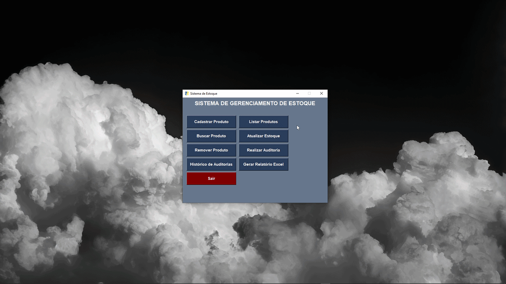
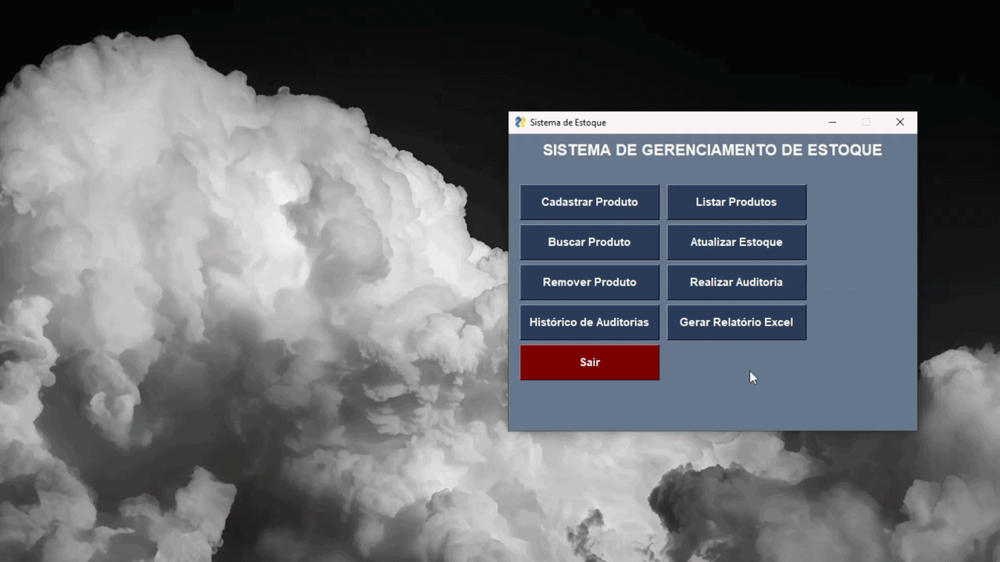

# Sistema de Gerenciamento e Auditoria de Estoque

Sistema desktop desenvolvido em Python para gerenciamento e auditoria de estoque multi-marketplace, permitindo controle de produtos, comparação de estoques externos, geração de relatórios e detecção de divergências operacionais.

---

# Sobre o Projeto

Este projeto foi desenvolvido em parceria com uma empresa, tendo como objetivo propor uma solução simples, prática e funcional para controle e auditoria de estoque distribuído entre diferentes marketplaces.

O sistema busca auxiliar no gerenciamento operacional de produtos comercializados em plataformas como:

* Shopee
* Mercado Livre
* Amazon

A proposta central consiste em permitir:

* cadastro de produtos;
* controle de estoque oficial;
* auditoria de estoques externos;
* identificação de divergências;
* geração automatizada de relatórios.

Além do desenvolvimento funcional da aplicação, o projeto também teve como foco a aplicação de conceitos de:

* engenharia de software;
* organização modular;
* persistência de dados;
* aplicações desktop;
* empacotamento executável.

---

# Funcionalidades

## Gerenciamento de Produtos

* Cadastro de produtos
* Busca por ID
* Atualização de estoque
* Remoção de produtos
* Listagem completa dos produtos
* Pesquisa dinâmica de produtos

## Auditoria de Estoque

* Comparação entre estoque oficial e marketplaces
* Registro histórico de auditorias
* Consolidação de dados operacionais
* Identificação de divergências

## Relatórios

* Exportação automática para Excel (`.xlsx`)
* Relatórios organizados para análise operacional

## Interface Gráfica

* Interface desktop desenvolvida com PySimpleGUI
* Sistema executável para Windows
* Inicialização automática do banco de dados
* Criação automática de diretórios do sistema

---

# Tecnologias Utilizadas

* Python
* SQLite
* PySimpleGUI
* OpenPyXL
* PyInstaller

---

# Demonstração da Interface

## Cadastro de Produtos

> Cadastro de produtos de forma intuítiva e prática.




---

## Auditoria de Estoque

> Valida uma auditoria através do ID do produto registrado.


---

## Relatórios Excel

> Faz a conversão automática dos detalhes da auditoria em planilhas no excel.



---

# Como Executar

## Executável (Recomendado)

O projeto possui versão executável para Windows.

Basta executar:

```txt
StockManager.exe
```

Não é necessário:

* instalar Python;
* instalar bibliotecas;
* configurar banco de dados.

O sistema realiza automaticamente:

* criação do banco SQLite;
* criação de diretórios;
* inicialização das tabelas.

---

# Execução via Código Fonte

## 1. Clonar o repositório

```bash
git clone <repositorio>
```

---

## 2. Criar ambiente virtual

```bash
python -m venv .venv
```

---

## 3. Ativar ambiente virtual

### Windows

```bash
.venv\Scripts\activate
```

### Linux/MacOS

```bash
source .venv/bin/activate
```

---

## 4. Instalar dependências

```bash
pip install -r requirements.txt
```

---

## 5. Executar o projeto

```bash
python main.py
```

---

# Geração do Executável

O executável foi gerado utilizando PyInstaller.

```bash
pyinstaller main.spec
```

---

# Autor

Desenvolvido por Mateus Monteiro em parceria com projeto acadêmico vinculado à faculdade e empresa colaboradora.
